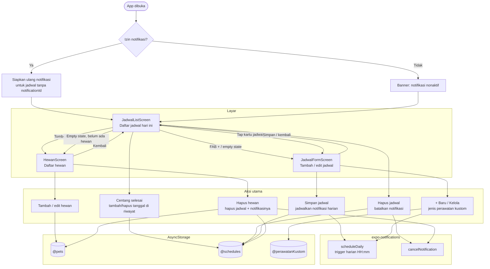
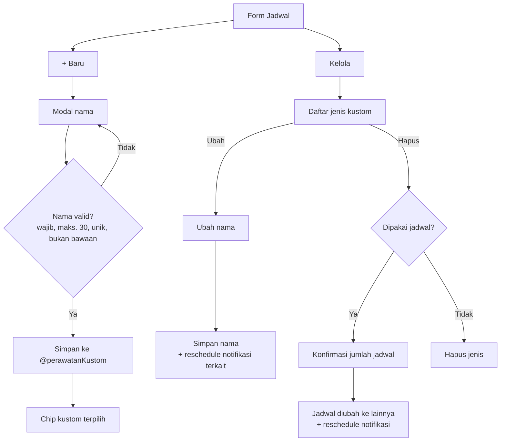

# PetPlanner — Flowchart

Dokumen ini berisi flowchart alur aplikasi PetPlanner. Diagram dirender oleh
GitHub dari blok Mermaid di bawah.

## 1. Alur utama aplikasi

## 2. Alur jenis perawatan kustom

## 3. Data yang disimpan

| Key | Bentuk data |
|---|---|
| `@pets` | `{ id, nama, jenis }` |
| `@schedules` | `{ id, petId, perawatan, jam, notificationId, riwayat }` |
| `@perawatanKustom` | `{ id, nama }` |

`perawatan` berisi `'makan'`, `'mandi'`, `'custom:<id>'`, atau nilai lama
`'lainnya'`. Status selesai hari ini dihitung dari `riwayat.includes(YYYY-MM-DD)`.
